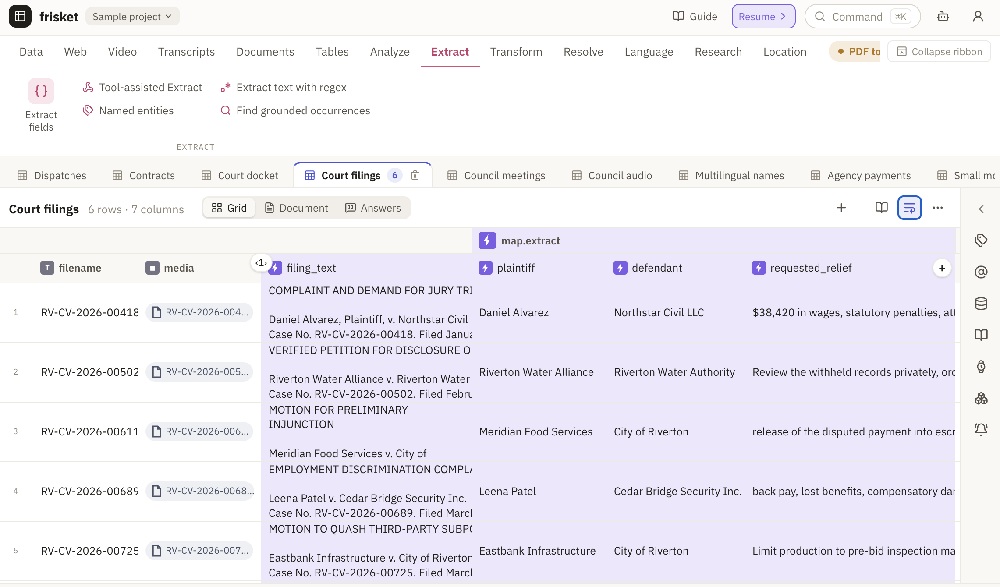

# Frisket

I wanted a spreadsheet that did AI things for investigative journalism. The NYT [made one for itself](https://www.niemanlab.org/2026/02/how-the-new-york-times-uses-a-custom-ai-tool-to-track-the-manosphere/), so I made one for the rest of us. Use Frisket to analyze zillions of documents, decades of audio, centuries of video, all in a friendly (???) spreadsheet format.



## Quickstart

Use [Frisket Desktop](#frisket-desktop), [Frisket Cloud](https://app.frisket.dev/), or [Frisket Self-Hosted](#frisket-self-hosted).

## What Frisket can do

Frisket can analyze spreadsheets, PDFs, images, videos, probably a hundred other things. You drop content in, then run AI against it in a structured way. It's a new way to do projects like:

- Extract and cross-reference [every company mentioned over thousands of legal documents](https://www.icij.org/investigations/fincen-files/mining-sars-data/)
- Find [every time datacenters are mentioned](https://datacentersexposed.com/hearings) in a YouTube channel of city council meetings
- Split a video at scene changes to [analyze popular streamers](https://www.bloomberg.com/features/2026-stake-drake-crypto-casino-adin-ross-gambling/)
- Download and translate TikTok videos [to track misinformation](https://documentedny.com/2025/01/07/tiktok-misinformation-data-ai-machine-learning/)
- Get an email or Slack message [summarizing this week's new podcast eps](https://www.niemanlab.org/2026/02/how-the-new-york-times-uses-a-custom-ai-tool-to-track-the-manosphere/)
- Convert recipes into [structured lists of ingredients and amounts](https://archive.nytimes.com/open.blogs.nytimes.com/2015/04/09/extracting-structured-data-from-recipes-using-conditional-random-fields/) (it isn't journalism but hey)
- Summarize, [categorize](https://www.wsj.com/tech/elon-musk-politics-trump-social-media-267d34c8), restructure, and clean documents
- Pull fields out of similarly formatted documents by drawing boxes around them, no AI needed
- Automatically perform cited research on the web

Those were all done the old-fashioned hard-work way, though. No one has done *anything* with Frisket yet, so you can be the first.

## Installation

### Frisket Desktop

- [Download for macOS](https://github.com/frisket-dev/frisket/releases/latest/download/Frisket-Desktop-arm64.dmg) (macOS 14+, Apple Silicon)
- [Download for Windows](https://github.com/frisket-dev/frisket/releases/latest/download/Frisket-Desktop-x64.exe) (Windows 11, x64)

To update, quit the app and install the new version. Your work stays put.

### Frisket Cloud

You're lazy, I get it! [Go to app.frisket.dev](https://app.frisket.dev/) and request access. This is a Frisket instance that I personally run.

### Frisket Self-Hosted

#### Single-user

If you just want to run Frisket on your own computer, use **solo mode**. You'll need Python 3.12.

```
pip install 'frisket-data[standard]'
frisket ./my-workspace
```

If you want more shiny extras, use `pip install 'frisket-data[complete]'`.

> Note that it is NOT installed with `frisket`, it's `frisket-data`. I got package-name-sniped!

#### Team

If you're running Frisket on a server or want to support multiple users, go for **team mode**.

1. [Download the server install bundle](https://github.com/frisket-dev/frisket/releases) (`frisket-server-<version>.tar.gz`)
2. Extract it, then run `sudo ./frisket-install` from the extracted directory
3. The installer asks a few questions and then you should be good to go. It can keep Frisket behind an SSH tunnel or serve a public domain using Caddy for HTTPS.

Codex claims it requires Linux, Docker Engine, and Docker Compose. It installs Frisket under `/srv/frisket`.

### CAVEAT: The big, fancy parts

Frisket is split into a few parts, including a lightweight server and a heavier sidecar to optionally offload intensive work. As a result, different installs have slightly different features.

The easy one: in solo mode, pick Docling as your PDF-to-Markdown engine and click **Download and set up**. Frisket handles the rest.

For everything else in the sidecar (like the [dots.mocr](https://github.com/studio-dots-ai/dots.ocr) OCR that Cloud uses), build the image yourself from the repo root:

```
docker build -t frisket-models:local ./sidecar
```

Then run the sidecar and connect it to Frisket.

```
MODELS_TOKEN="$(openssl rand -hex 32)"

docker run -d \
    --name frisket-models \
    --restart unless-stopped \
    -p 127.0.0.1:8500:8500 \
    -e FRISKET_MODELS_TOKEN="$MODELS_TOKEN" \
    -v frisket-models-cache:/models \
    frisket-models:local

export FRISKET_MODELS_URL=http://127.0.0.1:8500
export FRISKET_MODELS_TOKEN="$MODELS_TOKEN"

frisket ./my-workspace
```

**I haven't set the local sidecar up to easily publish yet**, but I promise you can ask your agentic coding environment and it can walk you through the process.

## Extras

### Local models

> Fair warning: some of these aren't yet available without some additional setup.

It's easy to set up an API key to talk to AI providers like OpenAI, Anthropic, OpenRouter and Gemini. But! You can also do most everything on the privacy of your own machine.

- LM Studio and Ollama are supported out-of-the-box for local LLMs/VLMs
- Local transcription can be powered by Parakeet, Whisper, MOSS, VibeVoice-ASR
- spaCy or GLiNER for local entity extraction
- Plenty of OCR engines like RapidOCR, Indra OCR, Surya 2, dots.mocr, PaddleOCR-VL, Tesseract
- PDF to Markdown conversion with Markitdown, Docling
- Clef for fast classification, either on your own model server or through Cloudflare

Paid document services like [OpenDocRouter](https://www.opendocrouter.ai/) work too; just add an API key in the engine picker.

### Ask

Ask is a chatbot that knows about your project. Turn on **Run actions** in its settings and it can convert documents, extract fields, and analyze the results for you, within whatever budget and approval level you set.

You can teach it repeatable workflows with **skills**: short instruction files you write in **Settings → Skills** (or ask Ask to write one for you).

Want to see what it's doing? Point the standard `OTEL_EXPORTER_OTLP_*` environment variables at Braintrust or any other OTLP backend.

### Clean up disk space

Old projects can accumulate files they no longer need. With Frisket stopped:

```sh
frisket cleanup ./my-workspace/my-project.frisket          # see what would go
frisket cleanup ./my-workspace/my-project.frisket --apply  # actually delete it
```

## Write a plugin

Plugins can add actions, panels, imports, integrations: pretty much anything. They're easy to make!

```
frisket plugin init --id example.my-plugin --output ./my-plugin --with action
frisket plugin build ./my-plugin
frisket plugin validate ./my-plugin
```

## Me

Hi, I'm [Soma](https://twitter.com/dangerscarf)!

I teach data journalism at Columbia's J-School where I run a year-long [Data Journalism MS](https://journalism.columbia.edu/ms-data-journalism) and a nice short [summer program](https://ledeprogram.com/). I give a lot of [talks on AI](https://jonathansoma.com/) and wrote history's friendliest [PDF-processing library](https://jsoma.github.io/natural-pdf-workshop/).

Email me at [jonathan.soma@gmail.com](mailto:jonathan.soma@gmail.com).

People say things like "oh buy me a coffee if you like this" but no, I'm more demanding: go [look at these poor cats](https://www.instagram.com/catrepublic) and then [donate to my cat rescue](https://catrepublic.com/donate/).
